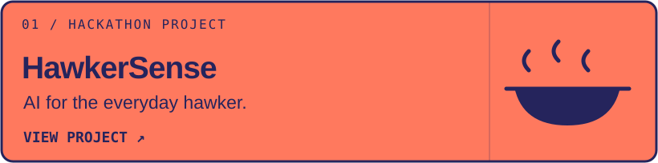
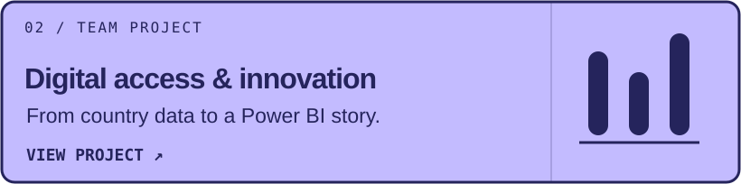
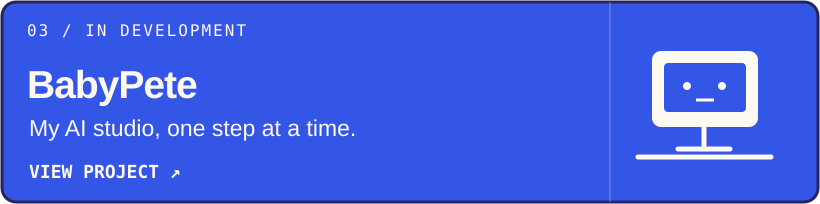

  

  <a href="#projects">Projects</a> &nbsp; · &nbsp;
  <a href="#on-my-build-list">On my build list</a> &nbsp; · &nbsp;
  <a href="#tools-i-work-with">Tools</a> &nbsp; · &nbsp;
  <a href="#a-little-about-me">About</a>

I'm **Peter**, a Computer Science and Data Analytics in Business Intelligence student in Singapore. I like figuring out how things work, spotting where a process gets stuck, and seeing what I can build to improve it.

You'll find a mix here: dashboards, AI tools, automation and experiments with financial data. I'm looking for **analyst and technology roles** where I can keep learning and work on real business problems.

## Projects

Sales records, notebook-photo extraction and demand forecasts, with the hawker reviewing the final plan.  
Python · FastAPI · React · Firebase · Google Cloud AI

Internet use and patent activity in Germany and Poland. My focus: **Power BI modelling, DAX, filters and forecast visuals**.  
Power BI · DAX · Power Query · Python · Team coursework

An animated office for my AI development workflow: tasks, roles, returned reviews and decisions in one place. Still a **supervised prototype**.  
Python · SQLite · Google ADK

Equity and gold ETF research with replay logic and accounting checks. Historical testing is underway; prospective paper validation is a separate next step.  
Python · Backtesting · Offline tests · Live trading blocked

Click a project card for its overview. Source repositories remain private.

## On my build list

A few things I want to explore next. These are **plans and ideas**, with no promised release dates.

| | Project | What I want to explore |
| :---: | :--- | :--- |
| ⚽ | **Football match analysis** | A YOLO-based computer vision project, planned for after exams. |
| 📊 | **Company analysis dashboard** | Bring company performance, financial data and relevant news into one view, with automated updates. |
| 🎮 | **Mobile idle RPG** | A 2D idle action RPG, starting with a small playable prototype and exploring online features later. |

**Next steps for projects already in progress**

- **BabyPete:** move from supervised handoffs toward isolated workers, independent reviews and more automated delivery.
- **Quant research:** connect the research workflow to a guarded paper-trading setup and collect prospective observations.

## Tools I work with

I also use **C++ and Java**, and I'm interested in process mapping, requirements analysis and communicating findings clearly.

## A little about me

🎓 Studying **Computer Science + Data Analytics in Business Intelligence** at Murdoch University through Kaplan Singapore. Previously completed an IT diploma and an NUS Emeritus data analytics certificate.

🗂️ **Secretary, Murdoch IT Society Singapore.**

🛠️ I use AI throughout my learning and development workflow, and spend time checking the results and understanding what I ship.

📍 **Singapore** · Interested in **business analysis, BI, automation and applied AI**.

---

Usually learning something. Probably planning another project.

