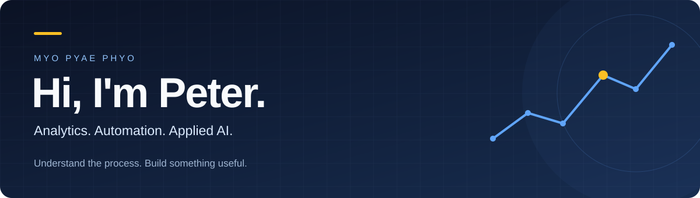

  

  <strong>Data analytics &amp; business intelligence · Process improvement · Practical software</strong>

  <a href="#selected-work">Selected work</a> &nbsp; / &nbsp;
  <a href="#toolkit">Toolkit</a> &nbsp; / &nbsp;
  <a href="#about-me">About me</a>

---

I'm **Myo Pyae Phyo (Peter)**, based in Singapore. I enjoy understanding how a business works, finding the tasks that slow people down, and building tools that help them make better decisions.

My work brings together **data analysis, dashboards, automation and applied AI**. I'm interested in analyst and technology roles where I can connect business needs with practical implementation.

## Selected work

<table>
<tr>
<td width="50%" valign="top">

### 01 / HawkerSense
**Applied AI for everyday operations**

A hackathon application that brings sales recording, stock tracking, demand forecasts and human-reviewed preparation guidance into a hawker's workflow.

Python · FastAPI · React · Firebase · Google Cloud AI

**[Read the project overview →](https://github.com/Ginnnyyyy/Ginnnyyyy/blob/main/projects/hawkersense.md)**  
[Explore the application ↗](https://hawkersense-848ba.web.app/)

</td>
<td width="50%" valign="top">

### 02 / Digital access & innovation
**Data modelling and business intelligence**

A team Power BI project comparing Germany and Poland through internet use and patent activity. My focus: the model, DAX, interactive visuals and forecast presentation.

Power BI · DAX · Power Query · Python

**[Read the project overview →](https://github.com/Ginnnyyyy/Ginnnyyyy/blob/main/projects/power-bi.md)**

</td>
</tr>
<tr>
<td width="50%" valign="top">

### 03 / BabyPete
**Making AI workflows visible**

A local animated office for tracking tasks, role definitions, returned reviews and owner decisions. Currently a supervised prototype, with further automation in development.

Python · SQLite · Google ADK

**[Read the project overview →](https://github.com/Ginnnyyyy/Ginnnyyyy/blob/main/projects/babypete.md)**

</td>
<td width="50%" valign="top">

### 04 / Quantitative research
**Research with explicit validation**

Historical equity and gold ETF experiments with portfolio accounting checks, replay logic and offline execution tests. Paper validation is a separate milestone.

Python · Backtesting · Accounting checks · Offline tests

**[Read the project overview →](https://github.com/Ginnnyyyy/Ginnnyyyy/blob/main/projects/quant-research.md)**

</td>
</tr>
</table>

These are public project summaries. Underlying repositories remain private. Team work is identified, and prototypes are described by their current capabilities.

## Toolkit

| Area | Tools and focus |
| :--- | :--- |
| Analytics & BI | Power BI, DAX, Power Query, Excel, SQL |
| Programming | Python, R, C++, Java |
| Applications & cloud | FastAPI, React, Firebase, Google Cloud |
| Engineering | Git/GitHub, automated checks, reproducible workflows |
| Business analysis | Process mapping, requirements, bottleneck analysis, decision support |

## How I approach a project

**Understand the process → Define the question → Build → Validate → Explain**

I use AI to support development and exploration, with attention to checking outputs, understanding limitations and keeping decisions reviewable.

## About me

- **Education:** Computer Science and Data Analytics in Business Intelligence at Murdoch University, through Kaplan Singapore.
- **Additional learning:** IT diploma and an NUS Emeritus data analytics certificate.
- **Leadership:** Secretary, Murdoch IT Society Singapore.
- **Interests:** Business analysis, automation, applied AI and financial data.
- **Career direction:** Analyst and technology opportunities where I can learn quickly and contribute to practical business improvements.

---

  <strong>Useful questions. Clear evidence. Practical tools.</strong> 
  Singapore · Open to analyst &amp; technology opportunities

